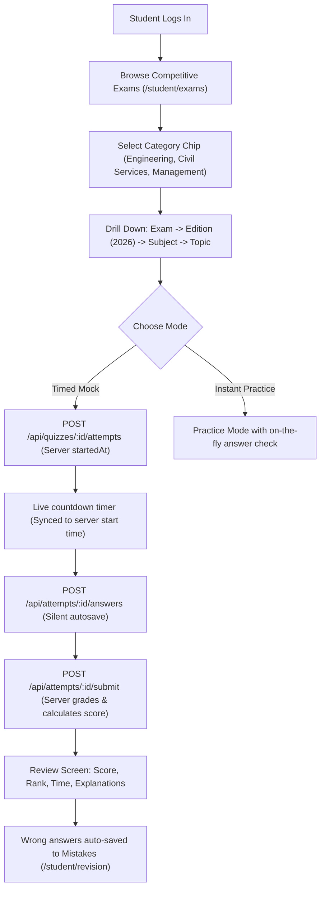
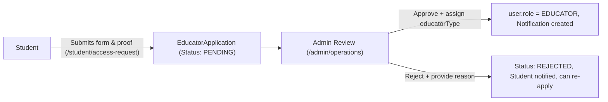
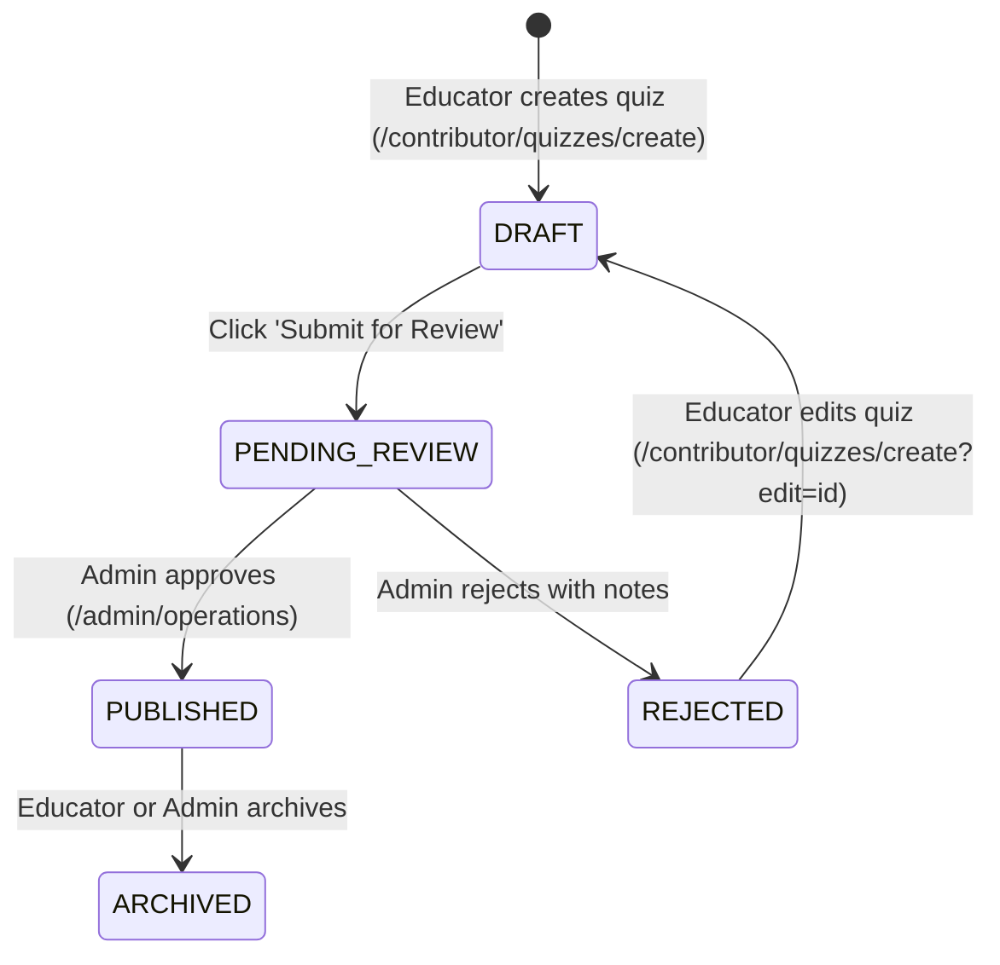
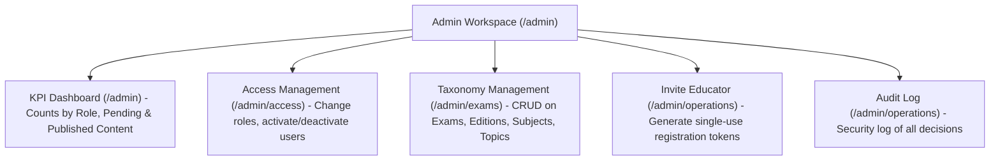

# Quizzify: Complete System Architecture & Operational Workflow

Welcome to **Quizzify** — a full-stack, enterprise-grade Online Quiz & Competitive Exam Preparation Platform. This document provides a complete end-to-end overview of the application architecture, data models, workflows, security boundaries, and operational procedures.

---

## 1. Technical Stack Overview

```
                      ┌─────────────────────────────────────────┐
                      │            React 18 + Vite              │
                      │  Tailwind CSS v4 • Recharts • Lucide   │
                      │         (Port 5173 - Frontend)          │
                      └────────────────────┬────────────────────┘
                                           │
                               HTTP / REST │ JSON + Session Cookies
                                           ▼
                      ┌─────────────────────────────────────────┐
                      │          Node.js + Express.js           │
                      │ JWT Cookies • Multer • Zod Validation   │
                      │         (Port 5000 - Backend)           │
                      └────────────────────┬────────────────────┘
                                           │
                            Sequelize ORM  │ PostgreSQL Dialect
                                           ▼
                      ┌─────────────────────────────────────────┐
                      │           PostgreSQL Database           │
                      │       quiz_app_db (18+ Schemas)         │
                      └─────────────────────────────────────────┘
```

| Layer | Technologies | Responsibilities |
| :--- | :--- | :--- |
| **Frontend** | React (Vite), React Router v6, Tailwind CSS v4, Recharts, Lucide Icons | Responsive UI, stateful routing, role-based UX navigation guards, real-time assessment countdown timer, instant practice feedback. |
| **Backend** | Node.js, Express.js, Sequelize ORM, Multer, Zod, Bcrypt.js | REST APIs, authentication, authorization middleware, input validation, attempt grading, transaction-safe database mutations. |
| **Database** | PostgreSQL 15+, Sequelize Migrations & Seeders | Relational persistence, UUID keys, JSONB question payload options, audit logs, and performance metrics. |

---

## 2. Roles & Privilege Matrix (RBAC)

Quizzify operates with three canonical roles in the database (`users.role`):

| Feature / Action | `STUDENT` | `EDUCATOR` | `ADMIN` |
| :--- | :---: | :---: | :---: |
| Browse competitive exams & syllabus | ✅ | ✅ | ✅ |
| Take mock exams (timed) & practice drills | ✅ | ✅ | ✅ |
| Track mistakes in Revision Folder | ✅ | ❌ | ❌ |
| Submit Educator Access Request | ✅ | ❌ *(Already educator)* | ❌ |
| Create Question Sets / Quizzes | ❌ | ✅ *(Drafts only)* | ✅ *(Direct publish)* |
| Upload questions in bulk via Excel/CSV | ❌ | ✅ | ✅ |
| Submit Quiz for Admin Review | ❌ | ✅ | ❌ |
| Edit & Resubmit rejected quizzes | ❌ | ✅ *(Own quizzes)* | ✅ |
| Archive published quizzes | ❌ | ✅ *(Own quizzes)* | ✅ |
| Approve / Reject Educator Applications | ❌ | ❌ | ✅ |
| Review Queue: Publish or Reject Quizzes | ❌ | ❌ | ✅ |
| Edit quiz content during review | ❌ | ❌ | ✅ |
| Modify User Roles & Account Status | ❌ | ❌ | ✅ |
| Manage Taxonomy (Exams, Editions, Topics) | ❌ | ❌ | ✅ |
| Generate Educator Single-Use Invites | ❌ | ❌ | ✅ |
| Inspect Platform Audit Logs | ❌ | ❌ | ✅ |

### Educator Affiliations (`educatorType`)
An `EDUCATOR` role has an associated `educatorType` attribute:
- **`COMPETITIVE`**: Authors exams mapped to national tracks (GATE, JEE Main, UPSC CSE, CAT).
- **`COLLEGE`** *(Faculty)*: Manages university courses, lecture notes, syllabus units, and campus quizzes.
- **`BOTH`**: Unrestricted access across both national exam tracks and university courses.

---

## 3. End-to-End Operational Workflows

### Workflow A: Student Practice & Assessment



1. **Catalog Exploration:**
   - Navigates to `/student/exams`.
   - Filters by category: `Engineering (GATE / JEE)`, `Civil Services (UPSC)`, `Management (CAT)`.
   - Target goal bookmarking allows students to track exams they are preparing for.
2. **Drill-down Hierarchy:**
   - Exam &rarr; Edition / Year (e.g. 2026) &rarr; Subject &rarr; Topic &rarr; List of Published Quizzes.
3. **Assessment Modes:**
   - **Timed Mock:** Countdown timer derived from server `startTime`. Answers autosave silently. If the timer expires, the attempt auto-submits.
   - **Practice Mode:** Provides immediate step-by-step feedback and explanations after each question choice.
4. **Grading & Mistakes Tracking:**
   - On submission, the server computes score, accuracy, and time spent.
   - Wrong answers are automatically written to `student_question_records` (`isMistake = true`), feeding the **Revision Hub** (`/student/revision`) and **Performance Trends** (`/student/performance`).

---

### Workflow B: Educator Access Request Flow



1. **Application Submission:**
   - A student navigates to `/student/access-request`.
   - Form fields: Full name, qualification, teaching experience, syllabus topics (multi-select), institution, proof file upload (PDF/PNG/JPEG) or link, and motivation statement.
   - A student can have only **one pending application** at any time.
2. **Admin Review:**
   - The admin opens `/admin/operations` &rarr; **Applications**.
   - Admin downloads/views private proof files, evaluates motivation, and selects an action:
     - **Approve:** Promotes `user.role` to `EDUCATOR` and sets `educatorType` (`COMPETITIVE`, `COLLEGE`, or `BOTH`).
     - **Reject:** Stores `rejectionReason`. The student is notified in-app and can re-apply after fixing issues.

---

### Workflow C: Educator Quiz Authoring & Review Pipeline



1. **Creating the Quiz:**
   - Educator visits `/contributor/quizzes/create`.
   - Selects Track (`Competitive` vs `College`) and maps to Exam, Edition, Subject, and Topic.
   - Adds questions manually (4 options, 1 correct option, explanation, difficulty, marks) or imports via bulk Excel template.
2. **Review Submission:**
   - Clicking **Submit for Review** moves status from `DRAFT` to `PENDING_REVIEW`.
   - Educators cannot directly publish. They can only view/edit quizzes where `ownerId === req.user.id`.
3. **Admin Decision:**
   - Admin opens `/admin/operations` &rarr; **Quiz review**.
   - Admin can preview every question and answer key, make edits directly, and click **Publish** (sets `status = PUBLISHED`, `publishedBy`, `publishedAt`) or **Reject** with feedback.

---

### Workflow D: Admin Governance & Taxonomy Management



1. **KPI Dashboard (`/admin`):**
   - Displays real-time counts for Students, Educators, Admins, Pending Applications, Pending Quizzes, Published Quizzes, and Total Attempts.
2. **Taxonomy Management (`/admin/exams`):**
   - Full CRUD support for Exams (code, category, track), Edition Years, Core Subjects, and Specific Topics.
3. **User Access Management (`/admin/access`):**
   - Search users by name or email, change role (`STUDENT`, `EDUCATOR`, `ADMIN`), toggle account status (`active` / `inactive`).
4. **Invite Educator:**
   - Admin creates an invite for an email with `educatorType`. System generates a single-use token valid for 7 days (`/register?invite=...`).

---

## 4. Database Schema Relationships

```
                     ┌───────────────┐
                     │     users     │
                     └───────┬───────┘
          ┌──────────────────┼──────────────────┐
          ▼                  ▼                  ▼
┌──────────────────┐ ┌───────────────┐ ┌──────────────────┐
│educator_applicat.│ │ quiz_attempts │ │   educator_inv   │
└──────────────────┘ └───────┬───────┘ └──────────────────┘
                             ▼
                     ┌───────────────┐
                     │attempt_answers│
                     └───────────────┘

                     ┌───────────────┐
                     │     exams     │
                     └───────┬───────┘
                             ▼
                     ┌───────────────┐
                     │ exam_editions │
                     └───────┬───────┘
                             ▼
                     ┌───────────────┐
                     │ exam_subjects │
                     └───────┬───────┘
                             ▼
                     ┌───────────────┐
                     │  exam_topics  │
                     └───────┬───────┘
                             ▼
                     ┌───────────────┐
                     │    quizzes    │
                     └───────┬───────┘
                             ▼
                     ┌───────────────┐
                     │   questions   │
                     └───────────────┘
```

- **`exams`**: National competitive exams (GATE, JEE Main, UPSC CSE, CAT) with `category` and `track = 'COMPETITIVE'`.
- **`exam_editions`**: Year-specific exam syllabus editions (e.g., 2026).
- **`exam_subjects`**: Core subjects under an edition (e.g., Engineering Mathematics, Physics, General Studies Paper I).
- **`exam_topics`**: Specific learning modules (e.g., Linear Algebra, Mechanics, Indian Polity).
- **`quizzes`**: Assessments linked to topics, authored by educators, featuring strict state validation (`status = 'PUBLISHED'`).
- **`questions`**: Multiple choice items containing 4 options (`optionA`..`optionD`), `correctOption`, `explanation`, and `marks`.
- **`quiz_attempts`**: Student attempts recording `startTime`, `submitTime`, `score`, and duration.
- **`attempt_answers`**: Row-level student answers checked against answer keys.
- **`student_question_records`**: Bookmarks and wrong answer mistake counters.
- **`audit_logs`**: Tamper-evident record of admin approvals, role upgrades, and quiz publishing.

---

## 5. Security & Verification Rules

1. **No Public Admin Registration:** Admin accounts can never be created via the register endpoint or client requests. They are created exclusively through seeders or existing admins.
2. **Server-Side Role Guarding:** Frontend route guards only guide UX. Every API endpoint enforces `authMiddleware` and `roleGuard` verifying the live database user.
3. **No Key Leaks Before Submission:** Student endpoints (`/api/topics/:id/quizzes`, `/api/quizzes/:id/attempts`) strictly exclude `correctOption`, `correctAnswers`, and `explanation` from payloads before submission.
4. **Password Hashing:** Standard bcrypt 10–12 salt rounds with timing-safe comparison on authentication.
5. **Secure Session Cookies:** HTTP-only cookies with configurable `SameSite` and `secure` flags.

---

## 6. How to Run & Test the Application

### Prerequisites
- Node.js v18+
- PostgreSQL 15+ running on `localhost:5432` with database `quiz_app_db`

### Step 1: Start Backend
```bash
cd backend
npm install
npm run dev
```
Backend will listen at `http://localhost:5000`.

### Step 2: Start Frontend
```bash
cd frontend
npm install
npm run dev
```
Frontend will launch at `http://localhost:5173`.

### Step 3: Run Security Test Suite
```bash
npm test --prefix backend
```
Executes all 12 security test cases (`node --test`).

---

## 7. Demo Accounts & Credentials

| Role | Email | Password | Primary URL |
| :--- | :--- | :--- | :--- |
| **Administrator** | `admin@quizapp.com` | `AdminSecurePass2026!` | [http://localhost:5173/admin](http://localhost:5173/admin) |
| **Educator (Competitive)** | `contributor1@quizapp.com` | `password123` | [http://localhost:5173/contributor](http://localhost:5173/contributor) |
| **Educator (College Faculty)** | `faculty1@quizapp.com` | `password123` | [http://localhost:5173/faculty](http://localhost:5173/faculty) |
| **Student** | `student1@quizapp.com` | `password123` | [http://localhost:5173/student](http://localhost:5173/student) |

